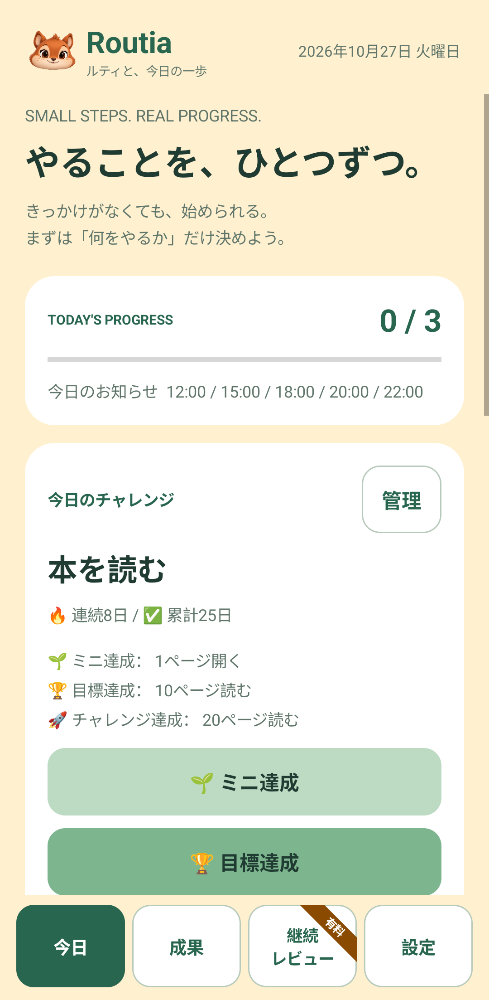
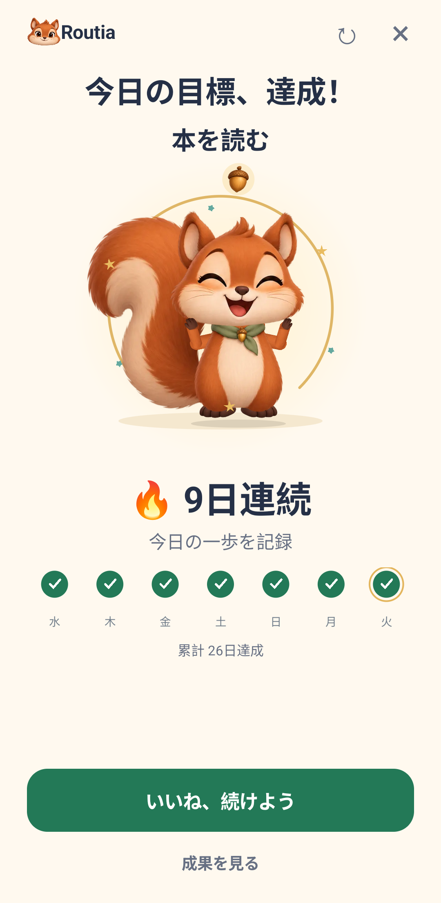
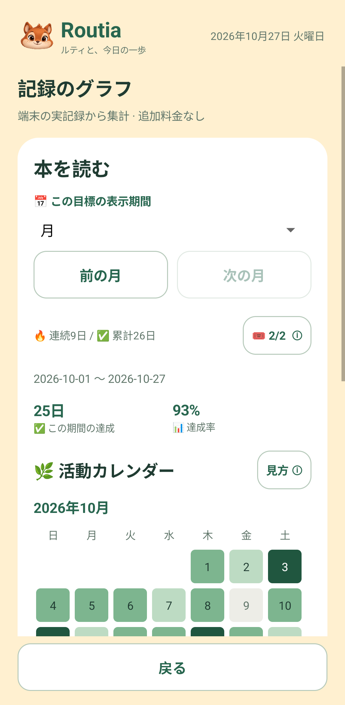
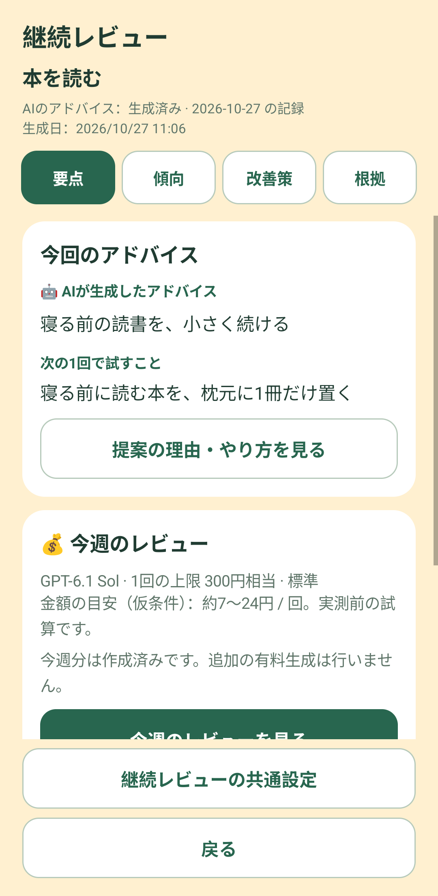
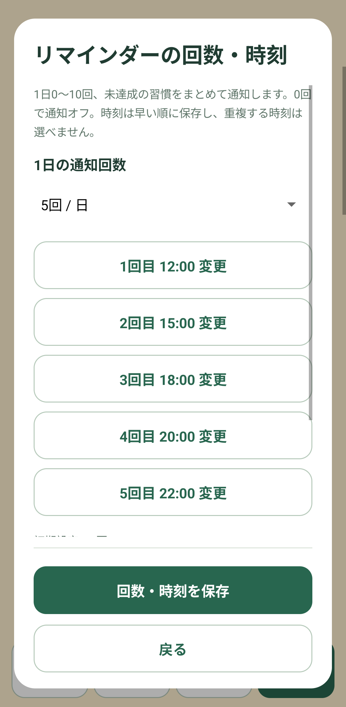
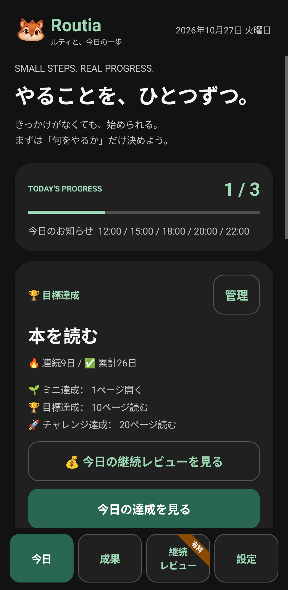

<p align="center">
  
</p>

<h1 align="center">Routia（ルーティア）</h1>

<p align="center"><strong>ルティと、今日の一歩。</strong><br>小さな達成を積み重ねる、Android向け習慣記録アプリ。</p>

<p align="center">Android 8.0+ · v1.0.0 · 通常の記録はオフライン · 広告・アカウント登録なし</p>

「今日は少しだけ」も成功として残す。Routiaは、できたかどうか・時間・数量で日々の習慣を記録し、連続日数や活動カレンダーで積み重ねを振り返るアプリです。リスの相棒「ルティ」が毎日の小さな一歩に寄り添います。

## 画面イメージ

最新版のアプリを検証用エミュレーターで撮影しています。習慣名・記録・レビュー本文はすべて表示用の架空データです。時計・通知バー・Androidのナビゲーションバーは含めていません。継続レビューの画像は表示例で、実際に有料APIで生成した結果ではありません。

<table>
  <tr>
    <th>今日の習慣を記録</th>
    <th>達成をルティとお祝い</th>
    <th>カレンダーで振り返る</th>
  </tr>
  <tr>
    <td></td>
    <td></td>
    <td></td>
  </tr>
  <tr>
    <th>継続レビュー〈任意・有料〉</th>
    <th>通知の回数と時刻</th>
    <th>ダーク・ブラック表示</th>
  </tr>
  <tr>
    <td></td>
    <td></td>
    <td></td>
  </tr>
</table>

## できること

| 機能 | 内容 |
|---|---|
| 習慣の登録 | 最初から最大10個。上限を変える設定は不要 |
| 3つの記録方法 | 「できたかだけ」「時間（分）」「回数・数量」 |
| 小さな達成 | ミニ達成・目標達成・チャレンジ達成。数値型は正の実績があれば成功 |
| 成果の確認 | 連続日数・累計日数・達成率・数量の集計と、週／月／年のカレンダー・グラフ |
| 継続チケット | 初回達成後に各習慣で月2枚。休みを自動でつなぎ、休んだ日は達成日数に加算しない |
| 集中タイマー | 時間型の習慣で1〜180分を計測。一時停止・再開・完走分の自動記録 |
| リマインダー | 1日0〜10回の時刻を選択。0回で停止、すべて達成した日はお知らせを休止 |
| ホーム画面ウィジェット | アプリを開く手間を減らして、記録や連続日数の確認 |
| 配色 | クリーム・ホワイト・ミント・スカイ・ローズ・ダーク・ブラック |
| 継続レビュー | 任意で有効にする、有料AIによる振り返り。「要点／傾向／改善策／根拠」の4タブ |

習慣の基準やきっかけはすべて任意です。空欄でも共通の初期値で始められ、あとから編集できます。ミニ達成や目標未満の数値記録も、続けた一日として扱います。

## インストール

[GitHub Releases](https://github.com/kkoch5t2/routia/releases/latest) から署名済みAPKを取得し、Android端末で開いてインストールします。配布元の許可が必要になる場合があります。既存利用者は同じ署名で上書き更新できます。記録を残す場合はアンインストールせず更新してください。

## 使い始める

1. 「今日」から最初の習慣をつくります。名前や達成基準はあとから変更できます。
2. 「できたかだけ」「時間」「回数・数量」から記録方法を選びます。
3. 実行したら達成ボタンを押すか、今日の合計時間・数量を入力します。
4. 「成果」で積み重ねを確認し、「グラフを見る」から期間を切り替えて振り返ります。
5. 必要に応じて「設定」で通知・配色・ウィジェットを整えます。

通知の初期値は **12:00／15:00／18:00／20:00／22:00の5回**です。Android側の通知許可が必要で、省電力設定などにより遅れたり届かなかったりする場合があります。

今日の記録は修正・取り消しができます。習慣を削除すると、その習慣の履歴も削除されます。

## 継続レビューと料金

**日々の記録・成果表示・タイマー・通知には、AIの契約やAPIキーは不要です。継続レビューを有効にした場合は、利用者自身のOpenAI API利用料が発生します。**

- 新規導入時は全体スイッチも各習慣の対象設定もオフです。
- 共通設定で自分のAPIキーを登録し、モデル・詳しさ・金額上限と対象の習慣を選びます。
- 全体をオンにする際は、自動生成の条件と週の最大予算を確認します。
- 自動生成は、オンにした翌日以降の「2日連続未達、または対象週で2日未達」が条件です。各習慣につき週1回までで、ミニ達成も成功に含みます。
- 手動生成にも料金確認があります。保存済みレビューを読むだけでは追加生成しません。
- 1回の上限は100〜1,000円相当、初期値300円です。固定料金ではなくAPI利用量に応じた実費で、上限を使い切る生成は行いません。
- 円換算は仮定を含むため、カード明細の最終円額を保証するものではありません。
- 全体をオフにすると未送信の新規生成を停止します。送信済みリクエストは取り消せず、結果不明の場合は重複課金を避けるため自動再送しません。

API料金はChatGPTの月額プランとは別です。AIの提案は仮説として表示し、習慣の定着や効果を保証しません。公開時点では、実APIを使った品質・請求額の検証は未実施です。

## データとプライバシー

通常の習慣・達成・メモ・集中履歴は端末内に保存します。Routiaのアカウント登録、広告、独自サーバーへの記録同期はありません。

継続レビューを利用した場合だけ、対象の目標・きっかけ・達成日・数値・集計・過去レビューをOpenAIへ送ります。生のメモと端末IDは送信しません。ただし、目標名やきっかけに個人情報を書いた場合は送信対象に含まれます。

APIキーはAndroid Keystoreを使って暗号化保存します。キー入力画面はスクリーンショットを防止し、ソースやAPKに利用者のキーを埋め込みません。

**クラウドバックアップ・端末移行バックアップは無効です。アンインストールやアプリのデータ消去で記録が失われるため、注意してください。**

## ビルドと検証

| 項目 | 設定 |
|---|---|
| 対応OS | Android 8.0以上（API 26+） |
| コンパイル／ターゲットSDK | Android SDK 35 |
| JDK | 17 |
| Android Gradle Plugin | 8.7.3 |
| Gradle | 8.10.2（Wrapper同梱） |
| アプリID | `app.routia` |
| 検証専用アプリID | `app.routia.reportqa` |

JDKとAndroid SDKを用意し、`JAVA_HOME` と `ANDROID_HOME` を環境に合わせて設定します。`local.properties` を使う場合もGitへ追加しないでください。

```bash
bash scripts/test-domain.sh
./gradlew --no-daemon lintRelease assembleRelease
```

署名鍵とパスワードファイルはソース外に置き、`scripts/sign-release.sh` を使います。公開ファイルの検査・署名・ソースZIPの作成手順は [PUBLICATION.md](PUBLICATION.md) にまとめています。

画面・DBの検証は、空の専用エミュレーターで行います。README用画面の生成も専用QAアプリに限定し、実機のデータを消したり架空の記録を入れたりしません。撮影手順は [docs/screenshots/README.md](docs/screenshots/README.md) を参照してください。

今回の公開準備の検証結果は [PUBLICATION-VERIFICATION.md](PUBLICATION-VERIFICATION.md) を参照してください。

## ライセンス・制作について

Routia独自のソース・文書・キャラクター素材は権利留保です。自由な再配布・商用利用を認めるオープンソースライセンスは付与していません。[LICENSE](LICENSE) と [第三者のライセンス](THIRD-PARTY-NOTICES.md) を参照してください。

ルティの画像素材はImageGenで制作し、Androidのネイティブ描画で表示・アニメーション化しています。素材の構成は [ASSETS.md](ASSETS.md)、過去の開発記録は [DEVELOPMENT-HISTORY.md](DEVELOPMENT-HISTORY.md)、継続レビューの設計は [AI-REPORTS.md](AI-REPORTS.md) を参照できます。

習慣形成・行動計画・進捗モニタリングの研究を参考にしていますが、特定の日数で習慣が必ず定着するとは説明していません。

- [Lallyほか（2010）：習慣形成](https://doi.org/10.1002/ejsp.674)
- [Gollwitzer & Sheeran（2006）：行動計画](https://doi.org/10.1016/S0065-2601(06)38002-1)
- [Harkinほか（2016）：進捗モニタリング](https://doi.org/10.1037/bul0000025)
